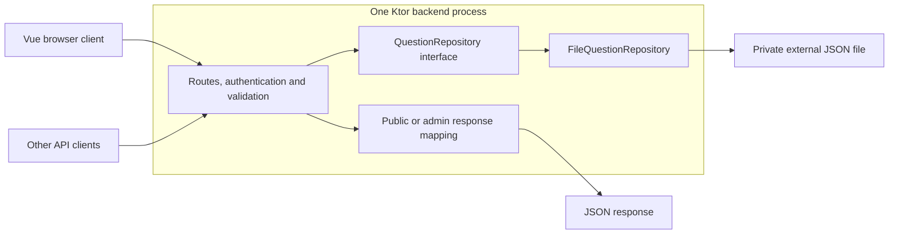

# Architecture and Design Patterns

- **Knowledge article url:** https://boksa.hbo-ict-hva.nl/profiles/full-stack-developer/design-and-realise/architecture-and-design-patterns/
- **Author:** Remzi Çavdar
- **AI disclosure:** I used OpenAI Codex to help analyse the current code and tests, structure the architecture
  decisions, and draft the explanations and alternatives below. I remain responsible for reviewing the content
  and explaining these decisions myself.

## Project context and decision criteria

I build Currency Quiz as a personal side project to demonstrate school learning outcomes. I am the only developer
and make the architecture decisions myself. Players can take the quiz without an account; one configured
administrator can manage questions. Teacher and learning-group feedback helps me improve my reasoning and documentation.

The current system has a Vue/TypeScript frontend, a Kotlin/Ktor REST API and an external JSON questions file.
The frontend and backend share an OpenAPI contract through a separate repository. My main architectural goal is
to keep this small application understandable, testable and affordable to maintain while protecting admin operations.

| Criterion | What it means for this project |
|---|---|
| Security | Check answers and admin permissions on the server, protect credentials, and reject invalid changes. |
| Privacy | Let people play without collecting profiles or storing their answer history; minimise authentication state and routine logs. |
| Maintainability | Keep HTTP, authentication and storage responsibilities identifiable, share API definitions, and test their boundaries. |
| Complexity | Operate one backend process and add layers or services when a concrete requirement justifies them. |
| Financial impact | Limit the services I need to run and the time I spend maintaining them. Application hosting, persistent storage and build resources still have costs. |

The records below explain why I keep the current choices, the alternatives and their drawbacks, and when I would
reconsider them. They use context, decision and consequences from
[Michael Nygard's architecture decision records](https://www.cognitect.com/blog/2011/11/15/documenting-architecture-decisions),
with explicit comparisons for this project.

## Current structure and request flow



For a public question request, the route reads a `Question` through the repository and returns its public view,
which excludes the correct answer. An answer request compares the submitted answer on the server. Admin changes
first require a valid access JWT; cookie-authenticated changes also require a trusted Origin and CSRF header.

The shared contract participates at build time: Gradle generates Kotlin models and packages the specification for
Swagger. The shared repository does not run another service or handle authentication at runtime.

## ADR-001: Keep one Ktor backend with logical layers

**Context and decision:** The backend mainly serves questions, checks answers and manages question content. I keep
these operations in one Kotlin/Ktor application, with separate files for routing, authentication, validation,
serialization, errors and persistence. Kotlin provides typed request handling and JVM library access; Ktor lets me
compose the HTTP features this API uses explicitly. This also gives me direct practice with backend design for school.

I keep the Vue client separate from the API so presentation stays in the frontend while answer checking, permissions
and persistence stay under backend control. The same API can serve browser and other HTTP clients. This gives me
practice maintaining a Kotlin/TypeScript boundary, at the cost of two toolchains, contract coordination and browser
origin/cookie configuration.

`Application.module()` creates settings and a `FileQuestionRepository`. `quizModule()` receives those dependencies
and installs the application features. Passing dependencies through constructors and function parameters keeps
the wiring visible and lets tests substitute a repository or a clock without a dependency-injection framework.

**Alternatives and why I do not use them here:**

| Alternative | Benefit | Why I keep the current approach |
|---|---|---|
| One server-rendered application | Fewer frontend/API integration concerns and one application toolchain. | A separate Vue client and Ktor API let me practise full-stack API integration and reuse the HTTP interface from other clients. I accept the extra coordination for that learning goal. |
| File operations directly in route handlers | Fewer types and less initial wiring. | Routes would also own file formats, concurrency and write failures, making HTTP behavior harder to test independently. |
| A use-case/service layer for every operation | A separate home for business workflows. | Most current operations would only forward a repository call. I would add it when workflows need coordination beyond simple CRUD and answer comparison. |
| Strict Clean/hexagonal architecture with separate modules and domain-only inputs | Stronger dependency boundaries. | More modules and model conversions would increase maintenance for this small domain. The repository interface already provides the storage seam I currently need. |
| Spring Boot or a DI container | More framework conventions and automatic wiring. | The current dependency graph is small enough to wire explicitly. Adopting those conventions would add migration and configuration work without solving a current requirement. |
| Microservices, separate read/write services or an event bus | Independent deployment and scaling of responsibilities. | I have one developer and no independently scaled business domains. Network failures, service credentials, messaging and multiple deployments would increase both operational work and hosting requirements. |

**Consequences:** One backend is easier for me to run and debug, but its failure affects the whole API. Logical
separation helps maintenance; it does not provide process isolation or automatically make the application secure.
Authentication and validation must still be enforced on each relevant route.

This is pragmatic layering: `QuestionRepository` accepts generated API request DTOs, answer comparison remains in
routing, validation helpers live in `RequestValidation.kt`, and the boundaries are not separate Gradle modules.
Describing it as fully independent domain layers would overstate the implementation.

**Evidence:** [Application.kt](../../../src/main/kotlin/Application.kt),
[Routing.kt](../../../src/main/kotlin/Routing.kt),
[QuestionRepository.kt](../../../src/main/kotlin/QuestionRepository.kt) and
[RoutingTest.kt](../../../src/test/kotlin/RoutingTest.kt).

## ADR-002: Use a repository with JSON-file storage for one process

**Context and decision:** The stored data is a small question collection with occasional admin edits. I use
`QuestionRepository` as a collection-like boundary, following the
[Repository idea](https://martinfowler.com/eaaCatalog/repository.html), and `FileQuestionRepository` as its current
implementation. This puts file access in one place and allows routing tests to supply controlled results and failures.

The repository keeps an in-memory snapshot and uses a coroutine `Mutex` to serialize access. Mutations run on
`Dispatchers.IO`, validate the complete resulting question, save a replacement snapshot, and only then publish it
in memory. A temporary file is moved atomically where supported, with ordinary replacement as a fallback.
This prevents a failed save from updating the in-memory question set, but does not provide database transaction durability.

Missing or blank storage is initialized from bundled seed data. An intentional empty array stays empty. Invalid
nonblank storage fails startup without replacing the source file. I favour preserving existing data over silently
restoring samples and losing admin changes.

**Alternatives and why I do not use them here:**

| Alternative | Benefit | Why I keep the current approach |
|---|---|---|
| In-memory data only | No persistence code or storage setup. | Admin changes would disappear on restart. |
| Write back into the bundled seed resource | Keep all content in the application package. | The resource is starter data inside the JAR. Mutable content needs an external writable location that survives application replacement. |
| SQLite | Local transactions, queries and schema constraints without a database server. | It is a reasonable next step, but the current list/find/update operations do not yet justify replacing the file adapter and adding SQL/schema maintenance. It would still need retained local storage. |
| A shared database such as PostgreSQL | Coordinate multiple backend instances and support richer queries. | It adds database setup, migrations, credentials, backups and another operated component. I would adopt it when shared writes, dataset size or recovery requirements justify that work. |

**Consequences:** There is no separate database service to configure or pay for, but persistent file hosting and
backups still require resources. I have not measured JSON against database hosting plans, so this is a reduction
in operated components rather than a claim that JSON is always cheapest.

The whole collection is loaded into memory and rewritten for each mutation. The mutex and cached map coordinate
only one repository instance; multiple processes or external file edits are unsupported. Atomic replacement depends
on the filesystem, and there is no automatic backup or recovery system. The file contains correct answers and must
remain private. Larger datasets, multiple replicas or stronger recovery requirements would trigger a storage review.

**Evidence:** [QuestionRepository.kt](../../../src/main/kotlin/QuestionRepository.kt) and
[QuestionRepositoryTest.kt](../../../src/test/kotlin/QuestionRepositoryTest.kt), including seeding, reloads,
concurrent changes, invalid storage and failed-write behavior.

## ADR-003: Use REST and one shared OpenAPI contract

**Context and decision:** Kotlin/JVM types cannot be imported directly by the TypeScript frontend. I keep one
language-neutral OpenAPI specification in `currency-quiz-shared`, pinned by each application's Git submodule.
REST resource routes and HTTP methods fit the question CRUD operations; `/api/v1` identifies the API's major URL version.

Gradle validates the specification, generates Kotlin DTOs into `build/generated/openapi`, and packages the same
specification as `documentation.yaml` for Swagger. The shared package supplies generated TypeScript declarations.
This avoids maintaining separate descriptions of the same JSON messages and a second backend documentation file.

**Alternatives and why I do not use them here:**

| Alternative | Benefit | Why I keep the current approach |
|---|---|---|
| Handwritten Kotlin and TypeScript DTOs | No generator to configure or update. | Every API change would require keeping duplicate definitions consistent manually. |
| A Kotlin-only shared library | Direct reuse between Kotlin applications. | It does not provide types the Vue/TypeScript application can import. |
| GraphQL | Clients can select fields and traverse related data. | The quiz has a small set of fixed responses. A schema/resolver/query layer would add work without a current need for flexible queries. |
| A generated server or complete client SDK | More generated endpoint and transport behavior. | Models-only generation leaves routing, HTTP calls, security and runtime validation explicit. I currently need shared message definitions rather than a generated application. |

**Consequences:** Contract updates are deliberate and reproducible through pinned revisions, but I must commit
shared changes in their standalone repository and update both consumers. Generator dependencies and configuration
also need maintenance. These are development-time costs even though shared runs no service.

Generated types do not validate incoming JSON or authorize requests. Runtime checks remain in the applications.
The backend's strict JSON decoding rejects unknown fields and coercion; request validation checks submitted fields,
and repository validation checks the merged question after PATCH. This prevents an options-only update from leaving
the stored correct answer outside the options. The public and admin response schemas also make the information
boundary explicit, although the implementation must still select the right view.

**Evidence:** [OpenAPI contract](../../../shared/openapi/currency-quiz.v1.yaml),
[build.gradle.kts](../../../build.gradle.kts), [Serialization.kt](../../../src/main/kotlin/Serialization.kt),
[RequestValidation.kt](../../../src/main/kotlin/RequestValidation.kt) and
[ContractTest.kt](../../../src/test/kotlin/ContractTest.kt).

## ADR-004: Keep one configured admin and stateless JWT authentication

**Context and decision:** Only I need to manage quiz content. I configure one admin username, a salted bcrypt
password hash and a signing secret. The hash utility uses cost 12 and a random salt; login uses the existing bcrypt
library to verify it. This avoids storing the plaintext password or implementing password cryptography myself.
The configured hash and signing secret still need protection.

Both bearer and browser credentials use signed JWTs. The application issues and verifies them with HMAC-SHA256.
One signer/verifier can use one secret without public-key distribution. Verification checks the signature,
issuer, audience, configured subject, admin role, token purpose and lifetime claims. Refresh JWTs cannot authorize
question mutations. JWT contents are signed, not encrypted, so possession also reveals the username and other claims.

| Token policy | Current default | Why |
|---|---|---|
| Access lifetime | 300 seconds | Limit how long a copied access credential can authorize requests. |
| Refresh lifetime | 600 seconds from issuance | Allow renewal without entering the password every five minutes, while requiring renewal before the current refresh expires. |
| Absolute login lifetime | 86,400 seconds (24 hours) | Bound continued renewal from the original sign-in. |

These defaults are configurable. Each successful browser refresh issues both JWTs again while preserving the original
signed `auth_time`, `absolute_exp` and CSRF nonce. Neither new token can outlive that deadline. Reading metadata or making
ordinary requests does not renew them; there is no separate activity registry or inactivity timer.

**Alternatives and why I do not use them here:**

| Alternative | Benefit | Why I keep the current approach |
|---|---|---|
| Opaque server sessions stored in memory, a database or Redis | Immediate session revocation and server-controlled logout. | I keep authentication independent of a retained session/token registry. A shared store would add storage operations and maintenance; an in-memory registry would be lost on restart. Immediate revocation would justify reconsidering this choice. |
| One long-lived access token | Simpler browser flow without refresh handling. | A copied token could authorize changes for the full long lifetime. Separate purposes and shorter access expiry reduce that window, at the cost of more auth code. |
| Asymmetric JWT signing | Let separate verifiers check tokens without holding the signing key. | The same backend currently signs and verifies. Separate issuer/verifier trust boundaries would justify the extra key-management work. |
| User registration or an external identity provider | Multiple admins, recovery, MFA and account lifecycle features. | Those requirements are absent from this personal quiz. They would add integration and maintenance work, and an external provider may add service costs. I would reassess if administration expands. |

**Consequences:** Authentication requires no session database, and tokens remain verifiable after a restart with
the same configuration. This does not make the whole application stateless: questions and rate-limit counters have state.

The security cost is explicit: logout clears cookies but cannot revoke copied JWTs. A replaced refresh JWT remains
usable until its own expiry; there is no single-use enforcement or replay detection. A copied refresh JWT and its
CSRF value can keep renewing credentials until the original absolute deadline. Rotating the signing secret invalidates
all JWTs together. The current approach fits one-admin operation only while I accept these revocation limits.

**Evidence:** [Security.kt](../../../src/main/kotlin/Security.kt),
[PasswordHash.kt](../../../src/main/kotlin/PasswordHash.kt), [JwtTokens.kt](../../../src/main/kotlin/JwtTokens.kt),
[ApiSettings.kt](../../../src/main/kotlin/ApiSettings.kt),
[StatelessAuthTest.kt](../../../src/test/kotlin/StatelessAuthTest.kt) and
[JwtTokensTest.kt](../../../src/test/kotlin/JwtTokensTest.kt).

## ADR-005: Separate public play from protected browser administration

**Context and decision:** Public players need prompts, options and answer checking; they do not need accounts or
admin credentials. `Question.publicView()` deliberately omits `correctAnswer`, while `adminView()` includes it.
The API checks answers on the server. Returning the full stored object and hiding the answer in the frontend would
disclose it to anyone inspecting a response. Explicit mapping makes this security boundary reviewable and testable.

For browser administration, access and refresh JWTs use host-only HttpOnly cookies with Secure and SameSite=Strict
defaults. The access path is `/api/v1`; the refresh path is `/api/v1/auth/session`. Browser JSON responses contain
username, expiry metadata and a CSRF nonce. API clients can obtain an access token through the bearer login route.

**Why cookies rather than browser localStorage:** HttpOnly prevents JavaScript from directly reading the JWT cookie.
Storing a bearer token in localStorage would make that credential readable by injected JavaScript. Cookies introduce
automatic credential attachment, so cookie-authenticated writes, refresh and logout also require an exact trusted
Origin and an `X-CSRF-Token` matching the nonce bound to the signed JWT. SameSite is an additional control;
[OWASP's CSRF guidance](https://cheatsheetseries.owasp.org/cheatsheets/Cross-Site_Request_Forgery_Prevention_Cheat_Sheet.html)
explains why cookie-based authentication needs request-forgery protection.

Public CORS may allow `*`, while credentialed access is enabled only for explicit admin origins. A small custom Ktor
plugin implements those two policies. Restricting all CORS to the admin frontend would reduce public browser reuse;
allowing credentialed administration from arbitrary origins would weaken the boundary. CORS itself does not grant
admin permission. An explicit Authorization header takes precedence and cannot fall back to a cookie if invalid.

**Privacy and operational tradeoffs:** The backend stores no player profiles or answer history and retains no
registry of authentication sessions or browser activity. Adding player accounts or analytics would create retention
and account-management work without serving the current quiz. Routine request logging records method, path and status
instead of bodies or credentials.
Central error handling returns generic unexpected errors while logging the internal cause for diagnosis.

Basic connection-IP rate limits use process-local counters: 5 login attempts per minute shared by both login routes,
30 refreshes per minute, and 30 answers per minute across question IDs. This avoids another service, but limits reset
on restart and cannot coordinate replicas. Shared school networks may share one limit; reverse proxies require
trusted proxy handling before connection IPs can reliably distinguish players.

**Consequences:** Cookie scope, Origin, CSRF and CORS add code and deployment configuration to maintain. HttpOnly does
not stop injected JavaScript from sending authenticated requests, so frontend XSS prevention still matters. The
custom CORS implementation needs regression coverage. Answer throttling reduces guessing without preventing it.
Connection IPs, the admin identity, internal error logs and hosting logs also mean that avoiding player accounts
does not eliminate personal-data handling. Hosting-log retention and production HTTPS need separate review.

**Evidence:** [Models.kt](../../../src/main/kotlin/Models.kt),
[AuthRouting.kt](../../../src/main/kotlin/AuthRouting.kt), [BrowserTokens.kt](../../../src/main/kotlin/BrowserTokens.kt),
[Http.kt](../../../src/main/kotlin/Http.kt), [RateLimiting.kt](../../../src/main/kotlin/RateLimiting.kt),
[StatusPages.kt](../../../src/main/kotlin/StatusPages.kt),
[BrowserSessionTest.kt](../../../src/test/kotlin/BrowserSessionTest.kt) and
[ServerTest.kt](../../../src/test/kotlin/ServerTest.kt). The
[secure coding document](secure-coding-practices.md) covers the threat model and remaining security work in more detail.

## ADR-006: Package one service and verify boundaries automatically

**Context and decision:** I need to run the same backend locally and in a container without rebuilding the runtime
setup by hand. The Docker build uses a JDK and runs `check shadowJar`; the runtime image uses a JRE and a dedicated
non-root user. Compose publishes on localhost and retains the external questions file in a named volume.
The health check uses HTTP to verify that the API responds.

Native JDK execution remains useful during development. Requiring every deployment environment to recreate that
setup manually would introduce more room for runtime differences. Docker adds image updates and build time, but
provides a repeatable package. Kubernetes or several separately deployed services would add infrastructure and
operating work beyond the current one-process requirement. A volume still needs backups; a responding health
endpoint does not prove stored data can be recovered.

I combine focused tests with integration tests. Mocked repository tests isolate routing and safe failure responses;
real temporary-file tests establish persistence behavior; Ktor test applications check HTTP, auth and validation
together. Using only mocks could miss file failures, while relying only on deployed tests would make failures harder
to isolate and require more environment setup.

Gradle `check` validates OpenAPI and enforces at least 90% line and 80% branch coverage for handwritten application
code. Generated DTOs are excluded from those thresholds and checked through contract interactions. GitHub Actions
runs validation, `check` and JAR packaging on pushes to `main`, pull requests and manual runs, and uploads the reports.
The workflow does not deploy the application. Automated checks cost build time but reduce repeated manual checking
and help me maintain the project alone; coverage percentages do not prove design quality or complete security.

**Evidence:** [Dockerfile](../../../Dockerfile), [compose.yaml](../../../compose.yaml),
[CI workflow](../../../.github/workflows/ci.yml), [build.gradle.kts](../../../build.gradle.kts),
[RoutingTest.kt](../../../src/test/kotlin/RoutingTest.kt),
[QuestionRepositoryTest.kt](../../../src/test/kotlin/QuestionRepositoryTest.kt) and
[ContractTest.kt](../../../src/test/kotlin/ContractTest.kt).

## Design patterns and changes visible in the code

The repository interface and file implementation separate callers from storage details. Manual dependency injection
puts concrete choices in the startup composition root. Explicit DTO mapping separates stored questions from public
responses. Ktor plugins centralise repeated HTTP concerns such as serialization, validation and error mapping.
These patterns earn their place through a concrete boundary or test seam; I do not add a pattern simply to name it.

Commit `8c681fa` replaced handwritten DTOs with generated contract models and removed the duplicate specification.
The repository interface already existed, so that change demonstrates removal of duplicated contract definitions
rather than a refactor from an unlayered application. Commit `545005a` replaced plaintext password configuration
with bcrypt. Commit `58ef13b` added renewal of both JWTs within the original login deadline. These changes explain
why the current design includes generation, password hashing and explicit token-lifetime policy.

The following inspection command works in **PowerShell 7+ and Linux/Bash**, from the backend root:

```sh
git show 8c681fa -- src/main/kotlin/Models.kt build.gradle.kts src/main/resources/documentation.yaml
```

## Verification and when to revisit the architecture

The checked-in tests verify API contracts, public answer omission, persistence failures, cookie/CSRF policy, token
purpose and expiry. Controlled-clock tests model repeated renewal through the original 24-hour deadline without
waiting a real day. They exercise the backend in process and do not establish deployed browser, proxy or TLS behavior.

The [testing document](../starting-points/testing-fundamentals.md) also records a local real-backend browser smoke
run on 10 November 2026 using shortened token lifetimes, and distinguishes it from the frontend's fake-API suite.
That smoke run is useful integration evidence, but it is not a checked-in end-to-end CI fixture or production check.

To run backend validation, tests and coverage gates in **PowerShell 7+**:

```powershell
./gradlew.bat check
```

In **Linux/Bash**:

```bash
./gradlew check
```

| New requirement | Architectural choice to reconsider |
|---|---|
| Multiple instances sharing question changes | Replace file storage with shared persistence and coordinate rate limiting. Stateless JWT verification alone does not enable this. |
| Larger datasets, richer queries or stronger recovery guarantees | Evaluate SQLite or a shared database, pagination, backup and restore procedures using measured needs. |
| Immediate logout revocation or refresh-reuse detection | Introduce server-side revocation/session state or an identity solution that provides those controls. |
| More administrators, recovery or MFA | Replace the single configured account with suitable identity and account-lifecycle management. |
| Business workflows beyond simple question CRUD | Add a use-case layer and stronger domain boundaries where those workflows need them. |
